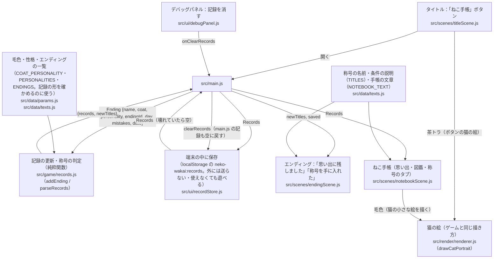
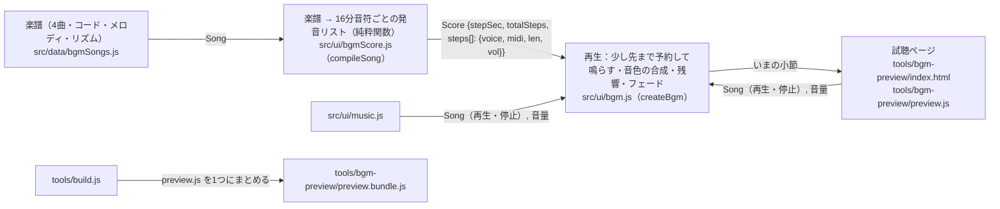
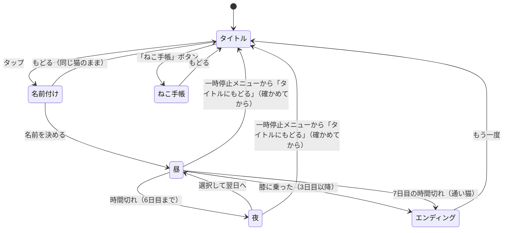

# 処理フロー：ネコと和解せよ（試作）

> 状態：**試作実装済み（検収待ち）**。構成が変わったら必ず更新する。

## 方針

- HTML + JavaScript + Canvas。ライブラリは使わない
- ソースは `src/` の ES Modules。`tools/build.js`（Node 標準機能のみ）で、1つの通常スクリプト `game.js` にまとめる。`index.html` は `game.js` を読むので、ダブルクリック（`file://`）でも GitHub Pages でもそのまま動く。遊ぶ人にビルド作業は不要
- `game.js` は生成物だがリポジトリに含める（GitHub Pages はビルドしないため）
- 猫・部屋の絵は Canvas、ボタン・説明カード・デバッグパネルは HTML 要素
- **ゲームの判定（`src/game/`）は描画や入力に依存しない純粋な関数にする**。乱数は外から渡す（シード付き）ので、Node の標準テスト機能（`node --test`）で検証できる
- 数値・文章は `src/data/` に分ける。調整するときはここだけを触ればよい

## モジュール構成と受け渡すデータ

```mermaid
flowchart TD
    BUILD["src/ をまとめて生成<br/>tools/build.js → game.js"] -.->|"npm run build"| HTML
    HTML["画面の土台・見た目<br/>index.html<br/>style.css<br/>game.js（生成物）"] --> MAIN

    MAIN["起動・ゲームループ・画面切替<br/>src/main.js"]
    MAIN -->|"GameState"| TITLE["タイトル画面<br/>src/scenes/titleScene.js"]
    MAIN -->|"GameState"| NAME["名前付け（猫のアップ）<br/>src/scenes/nameScene.js"]
    NAME -->|"catName／もどる（同じ猫のままタイトルへ）"| MAIN
    MAIN -->|"coat（毛色に合った名前の候補を出す）"| NAME
    MAIN -->|"GameState"| DAY["昼：駆け引き<br/>src/scenes/dayScene.js"]
    MAIN -->|"GameState"| NIGHT["夜：選択<br/>src/scenes/nightScene.js"]
    MAIN -->|"GameState"| END["エンディング<br/>src/scenes/endingScene.js"]

    INPUT["入力変換（タップ・クリック・キー）<br/>src/ui/input.js"] -->|"Action {type: pet / blink, holdMs}"| DAY
    DAY -->|"blink に sawLook（押している間に目が合ったか）を付ける"| DAY

    DAY -->|"Action, CatState, DayState, Params"| RULES["行動の判定（なでる・まばたきの信頼に性格の likes をかける。遠いまばたきは効きにくい（blink.far）。ツンの間＝信頼が shyUntil 未満のまばたきは信頼−3・blinkAway。手がこわい性格（timidHands）を信頼 timidUntil 未満でなでると timid。焦って触ったら（ミス）信頼−mistakeTrust。isShy）<br/>src/game/rules.js"]
    RULES -->|"ActionResult {CatState, DayState, feedback, mistake}"| DAY
    RULES -->|"isShy(trust, personality)（デレたトーストの判定・View の shy）・isTimid(trust, personality)（手が平気になったトーストの判定）"| DAY

    DAY -->|"CatState, DayState, Personality, dt, rng"| BRAIN["時間経過：様子の切替・移動（くつろぎの間だけ歩く。下限に着いたら座り、下限が walkResumeGap 下がるまで待つ）・警戒と信頼の自然増減・我慢のごほうび（お腹見せ・しっぽパタパタ・気まぐれすりすりを触らずにやり過ごしたら信頼+patienceTrust）。我慢のごほうびと背中の信頼には性格の likes.patience をかける・膝の判定（信頼が DayState.lapTrust 以上）<br/>src/game/catBrain.js（tick）"]
    BRAIN -->|"CatState（walking を含む）, DayState, enteredMode, endured（やり過ごせた様子。なければ null）"| DAY

    DAY -->|"イベントの日（DayState.event）：EventState, CatState, DayState, Personality, dt, rng"| EVT["イベントの進行。id で切り替える（箱が届いた：近づく→箱が置かれる→もぐる⇄顔を出す→出てくる／窓の外に鳥：近づく→背中を向けて鳥が来る→狩り→鳥が去る→振り向く、を2回／読書中：本をめくって読んでいる間だけ近づく→膝の前で本をのぞき込む→やめる、信頼が lapTrust 以上ならそのまま膝）。なでる・まばたきは、猫の様子を読み替えて rules に任せる（eventAct）。前の晩の段ボールの間（boxLockLeft）は待ってから始める。終わったら done、昼の画面はいつもの tick に戻る<br/>src/game/events.js"]
    EVT -->|"EventState, CatState, DayState, cues（箱：drop・hid・peek・watched・out／鳥：hunt・understood・left／読書：wonder・peekBook）／ActionResult"| DAY
    EVT -->|"ambient（残り時間・警戒の自然な減り）"| BRAIN
    EVT -->|"applyAction（look・inBox・backTurn・relax などに読み替えて）・isShy（箱で、ツンの間は見送れたら数える）"| RULES
    DATA -->|"EVENTS・EVENT_DAYS"| EVT
    DATA -->|"EVENTS.box（箱がすべり込む長さ）・EVENTS.bird（鳥が飛んでくる・去る長さ）"| RENDER
    RENDER -->|"hitTestBook（開いた本に当たったか。読書中は、本のタップを昼の画面が page に読み替える）・inBookArea（本の範囲か。猫が本をのぞき込んでいる間とやめた直後は、そこのタップを猫へのタッチにしない）"| DAY

    DAY -->|"説明カード（止める）/ 吹き出し・ヒント・トースト（止めない。我慢できたら「（ほっとしたみたい）」、初回だけ説明の吹き出し。ツンの間のまばたきは「（ぷいっ。照れて目をそらされた）」、2回目でヒント。ビビりをなでたら「（ビクビク……手はまだこわいみたい）」。信頼が shyUntil をまたいだ瞬間にデレたトースト、timidUntil をまたいだ瞬間に手が平気になったトーストを、それぞれ1回）/ 日付"| OVERLAY["チュートリアル・説明カード・吹き出し・トースト<br/>src/ui/overlay.js"]
    DAY -->|"鳴らす音（soundsFor：purr→ゴロゴロ / blinkBack→にゃーん / flee・kick→ぽふっ）。膝の上では直接ゴロゴロ（長め・大きめ）。読書中に本をめくったら page（パラッ）"| SOUND["効果音（WebAudioで合成・出口にリミッター）・振動・準備に失敗したら一度だけ知らせて効果音なしで続ける<br/>src/ui/sound.js"]
    MAIN -->|"ON/OFF"| SOUND
    MUSIC["BGMの選曲（左下の曲名をタップで次の曲／OFF）・端末に保存・音量（猫の声より約15dB小さく）・準備に失敗したら一度だけ知らせてBGMなしで続ける<br/>src/ui/music.js"] -->|"Song（再生・停止）"| BGMPLAY["BGMの再生<br/>src/ui/bgm.js（下の図）"]
    MAIN -->|"最初の操作で unlock"| MUSIC
    OVERLAY -->|"closed（一時停止の解除）"| DAY

    PROG["日の進行・解禁・夜の効果・エンディング判定<br/>src/game/progression.js"]
    DAY -->|"GameState"| PROG
    PROG -->|"DayState（その日の初期状態）, unlocks[]"| DAY
    DAY -->|"DayResult {lapped, trust, mistakes, dere, handsOk}"| PROG
    DAY -->|"DayResult.cat（昼の終わりの猫：mode, distance, walking）"| MAIN
    MAIN -->|"lastCat（夜の画面が実際の時間で0.5秒出しきるまで、同じ場所・姿で描く。そのあとは hidden＝帰っていて見えない）"| NIGHT
    NIGHT -->|"NightChoice"| PROG
    PROG -->|"GameState（更新後）"| MAIN
    PROG -->|"EndingId"| END

    DATA["数値・文章データ（毛色と性格の対応 COAT_PERSONALITY・言い伝え COAT_LORE・性格の得意・苦手 likes／shyUntil／timidHands／timidUntil・ひとこと PERSONALITY_TIPS を含む）<br/>src/data/params.js<br/>src/data/texts.js"] -->|"Params"| RULES
    DATA -->|"Params"| BRAIN
    DATA -->|"Params"| PROG
    DATA -->|"Texts"| OVERLAY
    DATA -->|"NAME_TEXT.byCoat（毛色ごとの名前の候補）"| NAME
    DATA -->|"COAT_LORE（柄の言い伝え）・PERSONALITY_TIPS（性格の得意・苦手）・ENDINGS"| END
    DATA -->|"BGM_TEXT・曲データ（src/data/bgmSongs.js）"| MUSIC

    DAY -->|"View {cat, wariness, blinkHoldMs, lapTime, dayTime（その日の進み具合 0〜1）, shy（ツンの間か）, prop（イベントの小道具）}"| RENDER["猫・部屋・膝の描画（Canvas。お腹見せの手前の足は胴体に重ねる）・毛色・性格の仕草（ツンデレはツンの間、見るときも目をそらす）・見つめる合図（チラッ）・歩く姿と蛇行する道すじ・膝に跳び乗る・タイトルに戻るとき／夜に帰っていくときは猫がその場で消え、タイトルの位置／次の日の昼のスタート位置に現れる（フェード）・ページを開いた直後は猫をはじめからその場面の位置に置く・まばたきゲージ・足あと・我慢できたときの「ほっ」（addEffect('relief')。窓の外に鳥で、見守れて鳥が去ったとき（cue 'understood'・'left'）と、箱でツンの間に見送れたとき（cue 'watched'）も）・ビビりの「ビクビク」（耳を伏せている間と addEffect('timid')）<br/>src/render/renderer.js"]
    MAIN -->|"coat, personality, face（顔の形：輪郭4種×耳3種。FACE_SHAPES・EAR_SIZES）"| RENDER
    RENDER -->|"View.prop（kind, phase, phaseT）。parcel：箱は猫が止まる位置に置いてその日のあいだ動かさず、猫が出て手前に来たら猫の奥に描く。bird：窓の外（部屋の窓の切り抜きの中）に枝・鳥・ガラスのつやを描き、狩りの間は猫の横に「カカカ」。book：膝の上に開いた本（めくる動き・ページ数。猫がのぞき込んでいる間も開いたまま）、本をのぞき込む猫（peekBook）は膝の前に座って首をかしげた姿で描き（膝には乗せない）、そのあとは閉じた本を右手に"| PROPS["イベントの小道具：通販の箱（ガムテープ・宛名ラベル・ワレモノ）・詰め物の紙・紙くず・「ドサッ」「？」「カサカサ」／窓の外の枝・小鳥／開いた本・閉じた本<br/>src/render/props.js"]
    RENDER -->|"dayTime（タイトル・名前付けは朝）, 夜かどうか"| LIGHT["時間帯の景色：朝→昼→夕方→夜の空の色・太陽／月・部屋にかける薄い色（猫は染めない）・床の日だまり・スタンドライトの明るさ<br/>src/render/daylight.js（daylightAt）"]
    LIGHT -->|"Daylight {phase, skyTop, skyBottom, hill, cloud, tint, lamp, sun, patch}"| RENDER
    DATA -->|"DAYLIGHT（時間帯の区切り）"| LIGHT
    DAY -->|"DayState"| HUD["日数・残り時間・まばたきボタン<br/>src/ui/hud.js"]
    PAUSE["一時停止メニュー（つづける／タイトルにもどる。もどる前に一度確かめる）<br/>src/ui/pauseMenu.js"] -->|"onResume / onQuit（やめた猫は思い出に残さない）"| MAIN
    MAIN -->|"open（一時停止ボタン・ほかのアプリやタブに切り替えたとき。昼と夜だけ）。開いている間は scene.update を呼ばず、なでる・まばたきも通さない（whilePlaying）。開くときに押しかけのまばたきを取り消す（input.cancelHold）。やめるときは昼の画面を stop（予約していたトーストも出さない）"| PAUSE
    DATA -->|"PAUSE_TEXT"| PAUSE

    DEBUG["デバッグパネル<br/>src/ui/debugPanel.js"] -->|"personality / coat / face / event（イベントの日の固定） / skipDay / trustMax / reset / speed / clearRecords"| MAIN
    MAIN -->|"固定した personality / coat（なければ null）"| PROG
    PROG -->|"chooseCat：毛色で性格が決まる（COAT_PERSONALITY）／chooseFace：顔の形は毛色と関係なくランダム（FACES）"| MAIN
    PROG -->|"chooseEvents：イベントを4〜6日目に1つずつ（EVENT_DAYS）。デバッグでは日を固定できる"| MAIN
    MAIN -->|"GameState, DayState, CatState"| DEBUG

    RNG["シード付き乱数<br/>src/util/rng.js"] -->|"rng()"| BRAIN
    RNG -->|"rng()"| PROG
```

### ねこ手帳（第3弾：思い出・図鑑・称号）

### BGM（ゲームでは src/ui/music.js から、試聴ページでは preview.js から鳴らす）

## 画面遷移

## データの形

| 名前 | 中身 | 持ち主 |
|---|---|---|
| GameState | `day`, `trust`, `personality`, `coat`（毛色）, `face`（顔の形 `{ shape, ears }`）, `catName`（名前）, `nightChoice`, `mistakes`, `seenCards`（表示済みの説明）, `seed`, `events`（日ごとのイベント。添字は日−1、なければ null）, `dere`・`handsOk`（ツンデレがデレた・ビビりの手が平気になったか。一度 true になったら戻らない。ツンのない性格の dere、手がこわくない性格の handsOk は、1日目から true） | `src/main.js` の `session.game`（更新は `progression.js` が返す） |
| Session | `game`（GameState）, `misses`（猫の様子ごとの失敗回数。ヒント用） | `src/main.js` |
| DayState | `dayNumber`, `trust`, `wariness`, `timeLeft`, `trustRate`（その日の DAYS の trustMul。1〜2日目は ×1.2。おやつの翌日はさらに ×0.85）, `lapTrust`（膝に乗る信頼。DAYS の lapTrust、なければ100。3日目は85）, `boxLockLeft`, `floorBonus`（おやつの日に距離の下限を近くする分）, `mistakes`, `actions`, `signs`, `canLap`, `approachMul`, `event`（その日のイベント。なければ null）, `dere`・`handsOk`（startDay が GameState と信頼から決め、昼の間に境目を越えたら dayScene が true にする。デバッグで性格を切り替えたら、dayScene が新しい性格と今の信頼で決め直す） | `src/scenes/dayScene.js` |
| CatState | `mode`（relax／look／tailUp／tailFlick／belly／backTurn／rub／fakeRub／purr／flee／inBox／lap。読書中だけ peekBook（膝の前で本をのぞき込む。日が終わるときは relax として渡す））, `distance`, `modeTimeLeft`, `walking`（くつろぎで歩いて近づいている間 true。描画で歩く姿にする）。夜の画面の猫だけ `hidden`（帰っていて見えない。`nightCatPose` が付け、描画でその場で消す） | `src/scenes/dayScene.js`（更新は `catBrain.js` / `rules.js` が返す） |
| Action | `{ type: 'pet' }` / `{ type: 'blink', holdMs, sawLook }` / `{ type: 'page' }`（読書中に本をタップ） | `src/ui/input.js` が作り、`sawLook` と `page` は `src/scenes/dayScene.js` が付ける・作る |
| View | `{ scene, cat, coat, face, personality, wariness, closeup, blinkHoldMs, lapTime, endingId, dayTime, shy, prop }`（dayTime・shy・prop は昼の画面だけ。prop はイベントの小道具。dayTime はその日の進み具合 0〜1、shy はツンデレのツンの間か） | 各画面の `view()` と `src/main.js` が作り、`src/render/renderer.js` が描く |
| EventState | `id`（box／bird／read）, `phase`（箱：approach／arrive／hop／hide／peek／happy／out。鳥：approach／arrive／hunt／leave／turn／happy／shy／out。読書：read／peekBook／out）, `phaseT`（いまの phase の経過秒）, `blinks`（通じたまばたきの回数。箱では、ツンの間に見送れた回数も足す）, `done`（終わったら true。いつもの日の動きに戻る）。箱だけ `hideFor`（今回もぐる長さ）、鳥だけ `round`（鳥が来て去った回数。触って邪魔した回も数える）・`watched`（狩りを最後まで見守れた回数。0 から 1 になる回に、わかってくれたごほうび）・`huntFor`（今回の狩りの長さ）。読書だけ `readLeft`（ページをめくってから、まだ読んでいる残り秒）・`pages`（めくったページ数）・`wondered`（読むのをやめて「……？」となったか） | `src/game/events.js`（昼の画面が持つ） |
| ActionResult | `{ cat, day, feedback: 'flee' \| 'kick' \| 'hide' \| 'stare' \| 'blinkBack' \| 'blinkAway' \| 'purr' \| 'timid' \| 'tooFar' \| null, mistake }` | `src/game/rules.js` が返す |
| DayResult | `{ lapped, trust, mistakes, dere, handsOk, cat }`（cat は昼の終わりの `{mode, distance, walking}`。progression は使わず、main.js が夜の画面に渡す） | `src/scenes/dayScene.js` が作る |
| NightChoice | `'treat' \| 'box' \| 'nothing'` | `src/scenes/nightScene.js` が作る |
| Ending | `{ name, coat, face, personality, endingId, day, mistakes, date }`（date は 'YYYY-MM-DD'。visitor の day は 7。face は思い出の絵に使う。古い記録にはない） | `src/main.js` がエンディングのときに作る |
| Records | `{ v: 1, memories: Ending[]（新しい順・最大50件）, dex: { [coat]: { stamps: endingId[], bestDay } }, titles: 称号id[], metCount }` | `src/main.js`（読み書きは `recordStore.js`、更新は `records.js` が返す） |
| EndingId | `'fate' \| 'patient' \| 'persistent' \| 'visitor'` | `src/game/progression.js` が返す |

## テスト

- 置き場所：`tests/*.test.js`（共通の状態生成は `tests/helpers.js`）。実行：`node --test` または `npm test`（Node 24 の標準機能。追加ライブラリなし）
- 対象：`src/game/rules.js`、`src/game/catBrain.js`、`src/game/progression.js`（すべて純粋関数）、`game.js` が最新か・通常スクリプトとして読めるか（`tests/bundle.test.js`）
- BGM：`tests/bgm.test.js` は曲の切り替え順（…→OFF→最初の曲）、楽譜の書式、小節をまたぐのばし、「メロディの長い音がコードの音（か9度）になっている」こと、試聴ページのスクリプトが最新かを確かめる
- 画面：`tests/scenes.test.js` は、夜の画面が表示しきるまで猫が昼の終わりの場所にいて、そのあと hidden（帰っていて見えない）になること、名前の候補が毛色に合っていること、「チラッ」が名前付けのアップに出ないこと、まばたきを返したら「にゃーん」が鳴ることを確かめる
- 描画：`tests/renderer.test.js` は描画命令を記録する偽の Canvas を使い、全ポーズで「毛色で塗った形に輪郭線がある」「塗っていない線（柄・白い部分）をこげ茶でなぞらない」こと、近づいただけの猫は膝の奥・膝に乗った猫は膝の手前に描くこと、手が袖口より手前にあること、手を伸ばしても袖があること、タイトルに戻るとき・夜から次の日に移るときに猫が見えたまま動かない（消えてから移り、毛色も消えている間に変わる）こと、ページを開いた直後に猫が滑ってこないこと、顔の形（輪郭4種×耳3種）ごとに輪郭が変わり、どの顔・どの姿勢でも輪郭線の決まりを守ること、夕方の部屋にかける色を猫より先に塗る（猫を染めない）ことを確かめる
- ねこ手帳：`tests/records.test.js` は、思い出の追加と50件の上限、図鑑のスタンプといちばん早い和解、称号の条件と「新しく手に入れたものだけ知らせる」こと、壊れた保存データを空の記録として読むこと、端末の保存が使えなくても例外を出さないことを確かめる。`tests/scenes.test.js` は、エンディングに「思い出に残しました」と新しい称号が出ることを確かめる
- 一時停止：`tests/pause.test.js` は、メニューの「つづける」で1回だけ再開し、「タイトルにもどる」は確認を挟んでから1回だけやめること、閉じたあとに古いボタンを押しても何も起きないこと、開いている間は遊びの操作を通さないことを確かめる。`tests/input.test.js` は押しかけのまばたきを取り消せること、`tests/scenes.test.js` は昼の画面を stop したら予約していたトーストを出さず一日も終えないことを確かめる
- 時間帯の景色：`tests/daylight.test.js` は、朝・昼・夕方・夜の名前と空の色、なめらかに変わること、部屋にかける色が薄いこと（0〜0.15）、スタンドライトが夕方からつくこと、太陽と月が窓の中にあることを確かめる
- 効果音：`tests/sound.test.js` は、効果音 OFF では「にゃーん」を鳴らさないこと、準備に失敗しても一度だけ知らせて例外を出さないことを確かめる
- 画面の確認：`index.html` をダブルクリックで開く
