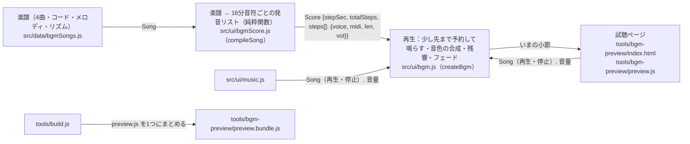
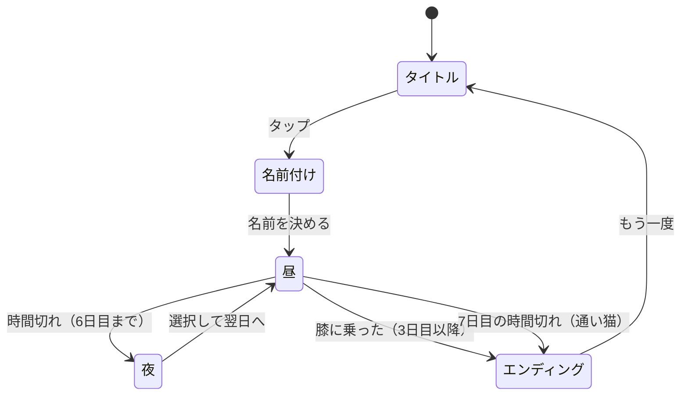

# 処理フロー：ネコと和解せよ（試作）

> 状態：**試作実装済み（検収待ち）**。構成が変わったら必ず更新する。

## 方針

- HTML + JavaScript + Canvas。ライブラリは使わない
- ソースは `src/` の ES Modules。`tools/build.js`（Node 標準機能のみ）で、1つの通常スクリプト `game.js` にまとめる。`index.html` は `game.js` を読むので、ダブルクリック（`file://`）でも GitHub Pages でもそのまま動く。遊ぶ人にビルド作業は不要
- `game.js` は生成物だがリポジトリに含める（GitHub Pages はビルドしないため）
- 猫・部屋の絵は Canvas、ボタン・説明カード・デバッグパネルは HTML 要素
- **ゲームの判定（`src/game/`）は描画や入力に依存しない純粋な関数にする**。乱数は外から渡す（シード付き）ので、Node の標準テスト機能（`node --test`）で検証できる
- 数値・文章は `src/data/` に分ける。調整するときはここだけを触ればよい

## モジュール構成と受け渡すデータ

```mermaid
flowchart TD
    BUILD["src/ をまとめて生成<br/>tools/build.js → game.js"] -.->|"npm run build"| HTML
    HTML["画面の土台・見た目<br/>index.html<br/>style.css<br/>game.js（生成物）"] --> MAIN

    MAIN["起動・ゲームループ・画面切替<br/>src/main.js"]
    MAIN -->|"GameState"| TITLE["タイトル画面<br/>src/scenes/titleScene.js"]
    MAIN -->|"GameState"| NAME["名前付け（猫のアップ）<br/>src/scenes/nameScene.js"]
    NAME -->|"catName"| MAIN
    MAIN -->|"coat（毛色に合った名前の候補を出す）"| NAME
    MAIN -->|"GameState"| DAY["昼：駆け引き<br/>src/scenes/dayScene.js"]
    MAIN -->|"GameState"| NIGHT["夜：選択<br/>src/scenes/nightScene.js"]
    MAIN -->|"GameState"| END["エンディング<br/>src/scenes/endingScene.js"]

    INPUT["入力変換（タップ・クリック・キー）<br/>src/ui/input.js"] -->|"Action {type: pet / blink, holdMs}"| DAY
    DAY -->|"blink に sawLook（押している間に目が合ったか）を付ける"| DAY

    DAY -->|"Action, CatState, DayState, Params"| RULES["行動の判定<br/>src/game/rules.js"]
    RULES -->|"ActionResult {CatState, DayState, feedback, mistake}"| DAY

    DAY -->|"CatState, DayState, Personality, dt, rng"| BRAIN["時間経過：様子の切替・移動（くつろぎの間だけ歩く）・警戒と信頼の自然増減・膝の判定<br/>src/game/catBrain.js（tick）"]
    BRAIN -->|"CatState（walking を含む）, DayState, enteredMode"| DAY

    DAY -->|"説明カード（止める）/ 吹き出し・ヒント・トースト（止めない）/ 日付"| OVERLAY["チュートリアル・説明カード・吹き出し・トースト<br/>src/ui/overlay.js"]
    DAY -->|"鳴らす音（soundsFor：purr→ゴロゴロ / blinkBack→にゃーん / flee・kick→ぽふっ）。膝の上では直接ゴロゴロ（長め・大きめ）"| SOUND["効果音（WebAudioで合成・出口にリミッター）・振動<br/>src/ui/sound.js"]
    MAIN -->|"ON/OFF"| SOUND
    MUSIC["BGMの選曲（左下の曲名をタップで次の曲／OFF）・端末に保存・音量（猫の声より約20dB小さく）・準備に失敗したら一度だけ知らせてBGMなしで続ける<br/>src/ui/music.js"] -->|"Song（再生・停止）"| BGMPLAY["BGMの再生<br/>src/ui/bgm.js（下の図）"]
    MAIN -->|"最初の操作で unlock"| MUSIC
    OVERLAY -->|"closed（一時停止の解除）"| DAY

    PROG["日の進行・解禁・夜の効果・エンディング判定<br/>src/game/progression.js"]
    DAY -->|"GameState"| PROG
    PROG -->|"DayState（その日の初期状態）, unlocks[]"| DAY
    DAY -->|"DayResult {lapped, trust, mistakes}"| PROG
    DAY -->|"DayResult.cat（昼の終わりの猫：mode, distance, walking）"| MAIN
    MAIN -->|"lastCat（夜の画面が実際の時間で0.5秒出しきるまで、同じ場所・姿で描く）"| NIGHT
    NIGHT -->|"NightChoice"| PROG
    PROG -->|"GameState（更新後）"| MAIN
    PROG -->|"EndingId"| END

    DATA["数値・文章データ（毛色と性格の対応 COAT_PERSONALITY・言い伝え COAT_LORE を含む）<br/>src/data/params.js<br/>src/data/texts.js"] -->|"Params"| RULES
    DATA -->|"Params"| BRAIN
    DATA -->|"Params"| PROG
    DATA -->|"Texts"| OVERLAY
    DATA -->|"NAME_TEXT.byCoat（毛色ごとの名前の候補）"| NAME
    DATA -->|"COAT_LORE（柄の言い伝え）・ENDINGS"| END
    DATA -->|"BGM_TEXT・曲データ（src/data/bgmSongs.js）"| MUSIC

    DAY -->|"View {cat, wariness, blinkHoldMs, lapTime}"| RENDER["猫・部屋・膝の描画（Canvas。お腹見せの手前の足は胴体に重ねる）・毛色・性格の仕草・見つめる合図（チラッ）・歩く姿と蛇行する道すじ・膝に跳び乗る・まばたきゲージ・足あと<br/>src/render/renderer.js"]
    MAIN -->|"coat, personality"| RENDER
    DAY -->|"DayState"| HUD["日数・残り時間・まばたきボタン<br/>src/ui/hud.js"]

    DEBUG["デバッグパネル<br/>src/ui/debugPanel.js"] -->|"personality / coat / skipDay / trustMax / reset / speed"| MAIN
    MAIN -->|"固定した personality / coat（なければ null）"| PROG
    PROG -->|"chooseCat：毛色で性格が決まる（COAT_PERSONALITY）"| MAIN
    MAIN -->|"GameState, DayState, CatState"| DEBUG

    RNG["シード付き乱数<br/>src/util/rng.js"] -->|"rng()"| BRAIN
    RNG -->|"rng()"| PROG
```

### BGM（ゲームでは src/ui/music.js から、試聴ページでは preview.js から鳴らす）

## 画面遷移

## データの形

| 名前 | 中身 | 持ち主 |
|---|---|---|
| GameState | `day`, `trust`, `personality`, `coat`（毛色）, `catName`（名前）, `nightChoice`, `mistakes`, `seenCards`（表示済みの説明）, `seed` | `src/main.js` の `session.game`（更新は `progression.js` が返す） |
| Session | `game`（GameState）, `misses`（猫の様子ごとの失敗回数。ヒント用） | `src/main.js` |
| DayState | `dayNumber`, `trust`, `wariness`, `timeLeft`, `trustRate`（おやつで ×0.85）, `boxLockLeft`, `floorBonus`（おやつの日に距離の下限を近くする分）, `mistakes`, `actions`, `signs`, `canLap`, `approachMul` | `src/scenes/dayScene.js` |
| CatState | `mode`（relax／look／tailUp／tailFlick／belly／backTurn／rub／fakeRub／purr／flee／inBox／lap）, `distance`, `modeTimeLeft`, `walking`（くつろぎで歩いて近づいている間 true。描画で歩く姿にする） | `src/scenes/dayScene.js`（更新は `catBrain.js` / `rules.js` が返す） |
| Action | `{ type: 'pet' }` / `{ type: 'blink', holdMs, sawLook }` | `src/ui/input.js` が作り、`sawLook` は `src/scenes/dayScene.js` が付ける |
| View | `{ scene, cat, coat, personality, wariness, closeup, blinkHoldMs, lapTime, endingId }` | 各画面の `view()` と `src/main.js` が作り、`src/render/renderer.js` が描く |
| ActionResult | `{ cat, day, feedback: 'flee' \| 'kick' \| 'hide' \| 'stare' \| 'blinkBack' \| 'purr' \| 'tooFar' \| null, mistake }` | `src/game/rules.js` が返す |
| DayResult | `{ lapped, trust, mistakes, cat }`（cat は昼の終わりの `{mode, distance, walking}`。progression は使わず、main.js が夜の画面に渡す） | `src/scenes/dayScene.js` が作る |
| NightChoice | `'treat' \| 'box' \| 'nothing'` | `src/scenes/nightScene.js` が作る |
| EndingId | `'fate' \| 'patient' \| 'persistent' \| 'visitor'` | `src/game/progression.js` が返す |

## テスト

- 置き場所：`tests/*.test.js`（共通の状態生成は `tests/helpers.js`）。実行：`node --test` または `npm test`（Node 24 の標準機能。追加ライブラリなし）
- 対象：`src/game/rules.js`、`src/game/catBrain.js`、`src/game/progression.js`（すべて純粋関数）、`game.js` が最新か・通常スクリプトとして読めるか（`tests/bundle.test.js`）
- BGM：`tests/bgm.test.js` は曲の切り替え順（…→OFF→最初の曲）、楽譜の書式、小節をまたぐのばし、「メロディの長い音がコードの音（か9度）になっている」こと、試聴ページのスクリプトが最新かを確かめる
- 画面：`tests/scenes.test.js` は、夜の画面が表示しきるまで猫が昼の終わりの場所にいること、名前の候補が毛色に合っていること、「チラッ」が名前付けのアップに出ないことを確かめる
- 描画：`tests/renderer.test.js` は描画命令を記録する偽の Canvas を使い、全ポーズで「毛色で塗った形に輪郭線がある」「塗っていない線（柄・白い部分）をこげ茶でなぞらない」こと、近づいただけの猫は膝の奥・膝に乗った猫は膝の手前に描くこと、手が袖口より手前にあること、手を伸ばしても袖があることを確かめる
- 画面の確認：`index.html` をダブルクリックで開く
